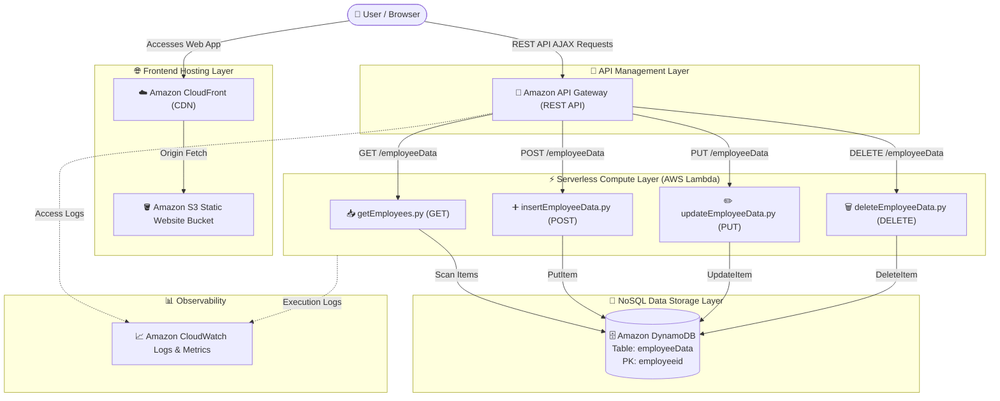

# 🚀 Empower EMS — AWS Serverless Employee Management System

[](https://aws.amazon.com/lambda/)
[](https://aws.amazon.com/dynamodb/)
[](https://aws.amazon.com/api-gateway/)
[](https://aws.amazon.com/s3/)
[](https://aws.amazon.com/cloudfront/)
[](https://www.python.org/)
[](#frontend)

---

## 📖 Overview

**Empower EMS** is a complete, enterprise-grade **Serverless Employee Management System** deployed on Amazon Web Services (AWS). It demonstrates a modern cloud-native architecture that delivers high availability, zero server maintenance, cost-effective scaling, and low latency for CRUD (Create, Read, Update, Delete) operations.

The frontend is built with clean HTML5, custom CSS styling, and jQuery/JavaScript communicating securely with a serverless backend powered by **Amazon API Gateway**, **AWS Lambda (Python)**, and **Amazon DynamoDB**.

---

## 🏗️ Architecture Diagram



---

## ✨ Features

- 📊 **Executive Dashboard**: Real-time statistics for total headcount, department distribution, total payroll, and average salary.
- ➕ **Employee Registration**: Fast onboarding form with instant input validation and duplicate prevention.
- 📋 **Directory & Real-time Search**: Live search and filtering by Employee ID, Name, or Department.
- ✏️ **Edit & Update Records**: Seamless in-place updates with instant feedback and database persistence.
- 🗑️ **Delete Management**: Safe deletion flow with confirmation prompts.
- 🎨 **Modern Responsive UI**: Clean typography (Inter), FontAwesome icons, glassmorphism cards, responsive sidebar layout, and dynamic toast notifications.
- 🔒 **CORS Enabled**: Robust cross-origin resource sharing configuration across all Lambda handlers and API Gateway stages.

---

## 📂 Project Structure

```text
serverless-project-devployemt/
│
├── frontend/
│   └── index.html                # Main UI dashboard, forms, and responsive styling
│
├── javascript/
│   └── scripts.js                # Frontend client logic, AJAX calls, form handlers & state
│
├── python-functions/             # AWS Lambda microservices (Python 3.x)
│   ├── insertEmployeeData.py     # Handles POST requests: creates new employee records
│   ├── getEmployees.py           # Handles GET requests: scans & retrieves all records
│   ├── updateEmployeeData.py     # Handles PUT requests: updates employee attributes
│   └── deleteEmployeeData.py     # Handles DELETE requests: removes employee by employeeid
│
├── screenshots/                  # Application screenshots and deployment verification
│   ├── Screenshot 2026-08-29 135938.png
│   ├── Screenshot 2026-08-29 140008.png
│   ├── ...
│
├── archicture-diagram/           # Architecture diagrams & schematics
├── README.md                     # Project documentation
└── README.txt                    # Legacy deployment notes
```

---

## 🔌 API Specifications

Base URL: `https://<api-id>.execute-api.<region>.amazonaws.com/<stage>/employeeData`

| Method | Route | Description | Request Body | Response (Success) |
| :--- | :--- | :--- | :--- | :--- |
| **`GET`** | `/employeeData` | Retrieve all employees | *None* | `200 OK` (Array of employee objects) |
| **`POST`** | `/employeeData` | Create a new employee | JSON (id, name, department, salary) | `200 OK` (`Employee data saved successfully!`) |
| **`PUT`** | `/employeeData` | Update existing employee | JSON (id, name, department, salary) | `200 OK` (`Employee updated successfully`) |
| **`DELETE`** | `/employeeData` | Delete an employee | JSON (`{"employeeid": "EMP001"}`) | `200 OK` (`Employee deleted successfully`) |

### Request Payload Examples

#### 1. Add Employee (`POST /employeeData`)
```json
{
  "employeeid": "EMP101",
  "name": "Kunal Sharma",
  "department": "Engineering",
  "salary": "85000"
}
```

#### 2. Update Employee (`PUT /employeeData`)
```json
{
  "employeeid": "EMP101",
  "name": "Kunal Sharma",
  "department": "DevOps",
  "salary": "95000"
}
```

#### 3. Delete Employee (`DELETE /employeeData`)
```json
{
  "employeeid": "EMP101"
}
```

---

## 🛠️ Step-by-Step AWS Deployment Guide

### 1. Amazon DynamoDB Setup
1. Navigate to the **AWS DynamoDB Console**.
2. Click **Create table**:
   - **Table name**: `employeeData`
   - **Partition key (Primary Key)**: `employeeid` (Type: `String`)
   - **Table class**: *DynamoDB Standard*
   - **Capacity mode**: *On-Demand* (or Provisioned with 5 RCU / 5 WCU)
3. Click **Create table**.

---

### 2. IAM Role for Lambda
Create an IAM execution role for Lambda with permissions to access DynamoDB and CloudWatch:
1. Open **IAM Console** > **Roles** > **Create role**.
2. Select **AWS service** > **Lambda**.
3. Attach the following managed policies:
   - `AWSLambdaBasicExecutionRole`
   - `AmazonDynamoDBFullAccess` *(or create a least-privilege policy for `employeeData` table)*.
4. Name the role: `LambdaDynamoDBEmployeeRole` and create it.

---

### 3. Deploy AWS Lambda Functions
Deploy four Lambda functions using Python 3.9+ runtime with the IAM role created above:

| Function Name | Source File | Handler | Trigger |
| :--- | :--- | :--- | :--- |
| `insertEmployeeData` | `python-functions/insertEmployeeData.py` | `insertEmployeeData.lambda_handler` | API Gateway (`POST`) |
| `getEmployees` | `python-functions/getEmployees.py` | `getEmployees.lambda_handler` | API Gateway (`GET`) |
| `updateEmployeeData` | `python-functions/updateEmployeeData.py` | `updateEmployeeData.lambda_handler` | API Gateway (`PUT`) |
| `deleteEmployeeData` | `python-functions/deleteEmployeeData.py` | `deleteEmployeeData.lambda_handler` | API Gateway (`DELETE`) |

> [!NOTE]
> Ensure the AWS Region matches across DynamoDB and Lambda (e.g. `ap-south-1`).

---

### 4. Amazon API Gateway Setup
1. Go to **API Gateway Console** > **Create API** > **REST API** (Build).
2. Name the API: `EmployeeAPI`.
3. Create Resource:
   - Resource Name: `employeeData`
   - Resource Path: `/employeeData`
   - Enable **API Gateway CORS** checkbox.
4. Create Methods under `/employeeData`:
   - **`POST`** -> Integrate with Lambda `insertEmployeeData` (Enable *Lambda Proxy integration* or method response).
   - **`GET`** -> Integrate with Lambda `getEmployees`.
   - **`PUT`** -> Integrate with Lambda `updateEmployeeData`.
   - **`DELETE`** -> Integrate with Lambda `deleteEmployeeData`.
   - **`OPTIONS`** -> Automatically created for CORS pre-flight.
5. Enable CORS on `/employeeData`:
   - Click **Enable CORS**.
   - Ensure `Access-Control-Allow-Origin: '*'` and allow methods `GET,POST,PUT,DELETE,OPTIONS`.
6. Click **Deploy API**:
   - Stage name: `employeeapi` (or `prod`).
   - Copy the **Invoke URL** (e.g., `https://<api-id>.execute-api.ap-south-1.amazonaws.com/employeeapi`).

---

### 5. Configure Frontend & S3 Hosting
1. Open [javascript/scripts.js](file:///d:/DevOps%20(31-05-26)/CLASS/Projects/serverless-project-devployemt/javascript/scripts.js) and update line 4 with your API Gateway Invoke URL:
   ```javascript
   var API_ENDPOINT = "https://<your-api-id>.execute-api.<region>.amazonaws.com/<stage>";
   ```
2. Navigate to **Amazon S3 Console** > **Create bucket** (e.g., `empower-ems-frontend-bucket`).
3. Enable **Static website hosting**:
   - Index document: `index.html`
4. Configure Bucket Policy or Origin Access Control (OAC) for public read access / CloudFront access.
5. Upload `frontend/index.html` and `javascript/scripts.js` (maintain matching relative paths or place `scripts.js` in a `javascript/` folder or alongside `index.html`).

---

### 6. CloudFront Distribution (Recommended)
1. Open **Amazon CloudFront** > **Create distribution**.
2. Set Origin Domain to your S3 bucket website endpoint.
3. Configure Default Root Object to `index.html`.
4. Deploy and access your application via the secure HTTPS CloudFront URL.

---

## 💻 Local Development & Testing

To preview and test the frontend locally:

```bash
# Option 1: Python HTTP Server (Inside repository root)
python -m http.server 8080

# Option 2: Node.js http-server / live-server
npx http-server . -p 8080
```

Open your browser at `http://localhost:8080/frontend/index.html`.

---

## 🧪 Testing Lambda / API with cURL

```bash
# 1. Insert an employee
curl -X POST "https://<api-id>.execute-api.ap-south-1.amazonaws.com/employeeapi/employeeData" \
  -H "Content-Type: application/json" \
  -d '{"employeeid":"EMP500","name":"Alex Mercer","department":"IT","salary":"75000"}'

# 2. Retrieve all employees
curl -X GET "https://<api-id>.execute-api.ap-south-1.amazonaws.com/employeeapi/employeeData"

# 3. Update an employee
curl -X PUT "https://<api-id>.execute-api.ap-south-1.amazonaws.com/employeeapi/employeeData" \
  -H "Content-Type: application/json" \
  -d '{"employeeid":"EMP500","name":"Alex Mercer","department":"Cybersecurity","salary":"92000"}'

# 4. Delete an employee
curl -X DELETE "https://<api-id>.execute-api.ap-south-1.amazonaws.com/employeeapi/employeeData" \
  -H "Content-Type: application/json" \
  -d '{"employeeid":"EMP500"}'
```

---

## 📸 Screenshots & Verification

| Dashboard & Overview | Employee Directory & Actions |
| :---: | :---: |
|  |  |

| Add Employee Form | DynamoDB Data Records |
| :---: | :---: |
|  |  |

---

## 🛡️ Best Practices Implemented

- ✅ **Serverless & Zero Maintenance**: Fully automated scaling from 0 to thousands of requests.
- ✅ **Stateless Compute**: Isolated AWS Lambda handlers with standardized error handling and status codes.
- ✅ **Secure CORS Handling**: Explicit CORS headers returned from both API Gateway and Lambda functions.
- ✅ **Single Partition Key Design**: High performance $O(1)$ key-value lookups on DynamoDB table using `employeeid`.
- ✅ **Graceful Error Handling & UX Feedback**: Client-side validation and toast notifications for user interactions.

---

## 👤 Author & Maintainer

**Kunal** — *Cloud & DevOps Engineer*

[](https://www.linkedin.com/in/your-linkedin-username/)
[](https://github.com/your-github-username)
[](mailto:your-email@example.com)

> 💡 *Feel free to connect on LinkedIn or check out more cloud and DevOps projects!*

